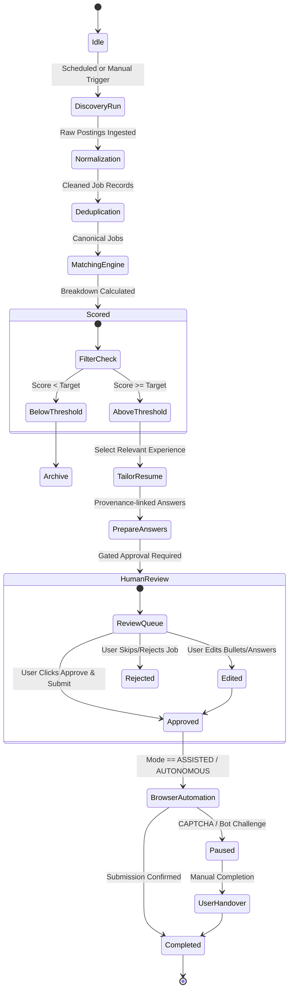

# Saarthi AI — Agent Orchestration & Intelligence Specification

## 1. Agent Philosophy: Employee, Not Bot

**Saarthi AI** functions as an autonomous, detail-oriented employee dedicated to the candidate's career search. It operates with transparency, humility, and strict adherence to verifiable facts.

### Core Tenet: Provable Truth
The agent possesses zero license to embellish, hallucinate, or assume candidate qualifications. If a job calls for "Kubernetes" and the candidate's verified skill bank does not contain Kubernetes, the agent:
1. Marks Kubernetes as **Missing (✗)** in the match report.
2. Does NOT inject Kubernetes into the resume.
3. Does NOT claim experience with Kubernetes in application answers.
4. Alerts the candidate transparently during application review.

---

## 2. Agent Execution Lifecycle & State Machine



---

## 3. Automation Modes & Human Gating

### Mode 1: MANUAL
- **Scope**: Scans sources, parses job descriptions, calculates match scores, surfaces recommendations.
- **Limitation**: Takes zero action toward generating tailored documents or opening browser sessions until explicitly triggered per job by the user.

### Mode 2: ASSISTED (Default)
- **Scope**:
  1. Identifies qualified openings ($Score \ge threshold$).
  2. Generates targeted resume version and factual cover letter.
  3. Pre-fills standard application answers from verified profile data.
  4. Launches browser automation to locate the application form and populate safe fields.
  5. **Mandatory Halt**: Stops immediately before the final "Submit" button.
  6. Presents the **Application Review Modal** with fields filled, answers given, and any flagged items.
  7. Final submission occurs *only* when the human clicks `[Approve & Submit]`.

### Mode 3: AUTONOMOUS
- **Scope**: Hands-off submission permitted **only** when all safety invariants are satisfied:
  - User has explicitly enabled Autonomous Mode in Automation Settings.
  - Job match score $\ge$ autonomous threshold (default: 85%).
  - 100% of required application fields are answered from verified profile records with confidence score $\ge 0.95$.
  - Zero ambiguous, legal, or compensation-related questions without predefined verified user answers.
  - Zero CAPTCHA or anti-bot challenge on the target page.
  - Daily submission cap is not exceeded.
- *Failsafe*: If any condition fails, the agent immediately downgrades the application to `ASSISTED` and alerts the user.

---

## 4. Provenance Tracking Engine

Every generated sentence, bullet point, and answer carries an explicit audit trail (`ResumeSource` / `ApplicationAnswer.sources`):

```json
{
  "generated_bullet": "Architected low-latency microservices with Node.js and PostgreSQL, reducing API response times by 35%.",
  "provenance": {
    "experience_id": "exp_01j7h8",
    "achievement_id": "ach_8829x",
    "verified": true,
    "confidence": 0.98,
    "source_text": "Built Node.js microservices with Postgres DB; improved latency by 35%."
  }
}
```

If a bullet cannot be linked to an existing record, the generation is rejected by the provenance validator.

---

## 5. Explainable Matching Formula

Job matching produces an explainable, component-wise breakdown rather than an opaque score:

$$\text{Total Score} = \sum (W_i \times S_i)$$

Where standard default weights are:
- **Skill Match** ($W_1 = 0.30$): Required skills (2x weight) vs. Preferred skills (1x weight).
- **Experience Match** ($W_2 = 0.20$): Years in relevant roles matching JD range.
- **Role Match** ($W_3 = 0.15$): Semantic alignment of candidate desired titles vs. JD title.
- **Location Match** ($W_4 = 0.10$): Remote compatibility, target cities.
- **Project Relevance** ($W_5 = 0.10$): Portfolio projects utilizing matching stack.
- **Education Match** ($W_6 = 0.05$): Degree level and field alignment.
- **Salary Match** ($W_7 = 0.05$): Compensation range compatibility.
- **Preference Match** ($W_8 = 0.05$): Industry, company size, employment type.

---

## 6. Safety & Security Guardrails

1. **Anti-Scraping & Terms Respect**: Strictly follows rate limits and backoffs on discovered endpoints.
2. **Zero CAPTCHA Bypassing**: CAPTCHAs, Cloudflare turnstiles, or MFA prompts immediately trigger an agent pause.
3. **No Secret Bleed**: Authentication tokens, session cookies, and API keys are never written to audit event logs or sent to client browsers.
