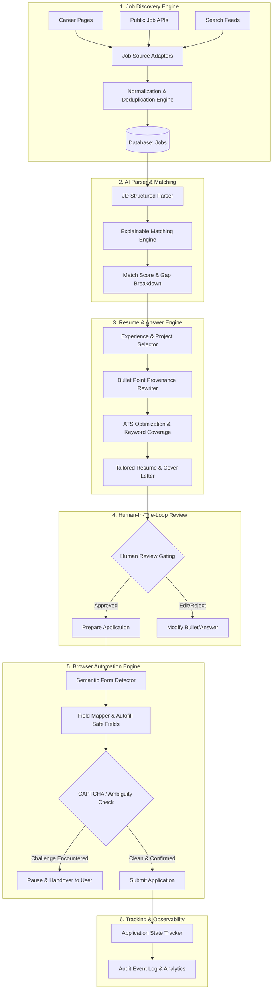

# Saarthi AI — System Architecture Specification

## 1. Overview & Architectural Principles

**Saarthi AI** is an autonomous, production-grade job search and application platform engineered as a personal AI job-search employee. Unlike generic job boards or unconstrained scraping bots, Saarthi AI operates under rigorous design principles:

1. **Accuracy Over Automation**: Zero fabrication of employment dates, company names, titles, technologies, skills, or metrics. Every generated resume bullet and application answer must maintain complete provenance linking back to verified user records.
2. **Human Control by Default**: Default workflow operates as `DISCOVER → ANALYZE → TAILOR → PREPARE → HUMAN REVIEW → SUBMIT`. Autonomous submission is gated behind strict verification criteria and explicit user authorization.
3. **Pluggable & Decoupled Architecture**: Modular job-source adapters, pluggable AI providers, separated queue workers, and strict semantic form mapping layers ensure zero vendor lock-in or brittle scraping logic.
4. **Zero-Config Local First**: Fully operational on local development environments without hard dependencies on container daemons, while retaining immediate production cloud readiness.

---

## 2. High-Level Monorepo Architecture

Saarthi AI is structured as a TypeScript monorepo orchestrated with **Turborepo** and **pnpm workspaces**:

```
saarthi/
├── apps/
│   ├── web/               # Next.js 15 App Router Frontend (Linear/Raycast aesthetic, Tailwind CSS)
│   ├── api/               # Fastify/Node.js REST API with strict Zod validation
│   └── worker/            # Background job runner (Async task processor & BullMQ compatible)
│
├── packages/
│   ├── database/          # Prisma ORM client & schema covering all 21 system entities
│   ├── ai/                # AIProvider interface (Gemini, OpenAI-compatible, Groq adapters)
│   ├── shared/            # Shared TypeScript types, Zod schemas, constants & status enums
│   └── config/            # Shared tsconfig and lint rules
│
├── docs/                  # System specifications & architecture blueprints
├── TODO.md                # Multi-phase engineering roadmap tracking
├── turbo.json             # Turborepo task pipeline
└── package.json           # Root monorepo configuration
```

---

## 3. End-to-End System Workflow



---

## 4. Key Subsystem Specifications

### 4.1. AI Provider Abstraction (`packages/ai`)
AI interactions do not hardcode vendor SDKs in business logic. All operations pass through the unified `AIProvider` contract:

```typescript
export interface AIProvider {
  name: string;
  generateText(prompt: string, options?: GenerationOptions): Promise<string>;
  generateStructured<T>(prompt: string, schema: z.ZodSchema<T>, options?: GenerationOptions): Promise<T>;
  embed(text: string): Promise<number[]>;
}
```

- **Google Gemini**: Default provider (`@google/genai` with `gemini-2.5-flash` or `gemini-1.5-pro` for reasoning).
- **OpenAI-Compatible**: Generic adapter supporting OpenAI, DeepSeek, or local Ollama instances.
- **Groq**: Low-latency inference adapter for high-speed resume keyword matching.

### 4.2. Database & Data Models (`packages/database`)
Prisma ORM is used with an entity model supporting 21 relational domains:
- **Identity & Profile**: `User`, `Profile`, `Skill`, `Experience`, `Achievement`, `Project`.
- **Resumes & Provenance**: `Resume`, `ResumeVersion`, `ResumeSource`.
- **Jobs & Discovery**: `Job`, `JobSource`, `JobSkill`, `JobMatch`.
- **Applications & Tracker**: `Application`, `ApplicationAnswer`, `ApplicationEvent`.
- **Agent Runs & Orchestration**: `AgentRun`, `AgentTask`, `AgentLog`.
- **Configuration & Rules**: `Notification`, `UserPreference`, `AutomationRule`.

Configured for zero-config local development (`SQLite`) with 100% portable schema for `PostgreSQL`.

### 4.3. API Layer (`apps/api`)
- Fastify server running TypeScript with fast startup, native schema validation via Zod, and secure HTTP-only cookie sessions.
- Clear domain route partitioning:
  - `/api/auth`: Login, registration, password hashing (Argon2/bcrypt), session check.
  - `/api/profile`: Master profile, experience bank, project bank.
  - `/api/jobs`: Discovery listings, filters, job match recalculation.
  - `/api/resumes`: Resume versions, PDF preview, provenance inspection.
  - `/api/applications`: Application status tracking, answers review, audit events.
  - `/api/agent`: Run status, task dispatches, structured execution logs.
  - `/api/analytics`: Conversion funnels, interview metrics, match averages.

### 4.4. Background Worker & Queue Engine (`apps/worker`)
- Modular task engine:
  - Local mode: In-process async task queue supporting concurrency limits, backoff retries, and cancellation tokens.
  - Distributed mode: BullMQ + Redis adapter for multi-instance scaling.
- Guarantees: No browser automation or long AI batch jobs run inside HTTP request handlers.

### 4.5. Frontend Application (`apps/web`)
- Next.js 15 App Router with Server Components for fast initial render and Client Components for dynamic controls.
- Design System: Inspired by Linear, Vercel, and Raycast. Monochromatic dark/light palette, high contrast, crisp typography, keyboard navigation, and responsive panels.

---

## 5. Security & Safety Architecture

1. **Secret Storage**: No plain-text storage of credentials or provider keys. All secrets read from environment variables or encrypted fields.
2. **Session Security**: HTTP-only, secure, SameSite cookies for session tokens.
3. **No-Bypass Guardrails**: The automation engine strictly forbids any programmatic attempt to bypass CAPTCHA, bot defense, or authentication walls.
4. **Immutable Audit Trail**: Every automated action creates an `ApplicationEvent` or `AgentLog` record documenting the timestamp, actor, action taken, and associated job/resume ID.
